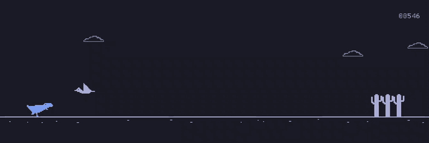

<div align="center">


# Rusty Rex

**The offline dinosaur runner from Chrome, rebuilt in Rust for Omarchy.**

[](https://github.com/yamz8/rusty-rex/actions/workflows/test.yml)
[](https://aur.archlinux.org/packages/rusty-rex)
[](https://github.com/yamz8/rusty-rex/releases/latest)
[](LICENSE)



</div>

## Features

- 🦖 **The game you know.** Cacti, pterodactyls, a speed that keeps ramping
  up, and night falling every 700 points.
- 🎨 **Follows your Omarchy theme.** Colours come from the current theme and
  change live when you switch.
- 🔊 **Synthesised sound.** Jump, milestone and crash sounds are generated in
  code, with no audio files.
- ⏱️ **Steady physics.** Fixed 120 Hz ticks, so jumps feel the same at any
  frame rate.
- 💾 **High score kept** in `~/.local/share/rusty-rex`.
- 📦 **One binary,** installed as an Arch package so it shows up in the app
  launcher.

## Install

From the AUR:

```sh
yay -S rusty-rex
```

Or download the x86_64 build, with its desktop entry and icon, from the
[latest release](https://github.com/yamz8/rusty-rex/releases/latest).

## How to play

| Key                | Action                                          |
| ------------------ | ----------------------------------------------- |
| <kbd>Space</kbd> / <kbd>↑</kbd> / click | Jump: hold for a higher jump, tap for a hop |
| <kbd>↓</kbd>       | Duck under pterodactyls, or drop faster mid-jump |
| <kbd>Enter</kbd>   | Play again straight after a crash               |
| <kbd>P</kbd>       | Pause; the game also pauses when it loses focus |
| <kbd>M</kbd>       | Mute                                            |
| <kbd>Esc</kbd>     | Quit                                            |

To reset the high score, click it twice on the game-over screen, as in
Chrome.

## Screensaver

`rusty-rex --screensaver` opens fullscreen on the waiting screen, and you
can play it: Space, Up or a click starts a run, and the keys work as in the
game. If nobody starts within 10 seconds, the rex plays by itself, timing
every jump and duck, and a jump takes over from it at any moment. Walk away
and it goes back to playing itself: 15 seconds after a crash, or 30 seconds
of a run left paused.

It's silent until you press M. Only runs you started count towards your
high score, never the ones it plays itself. Esc, or any key the game
doesn't use, quits; moving the mouse does nothing. While nobody plays it, it
draws at 30 FPS to go easy on the battery. Omarchy shows it as the screensaver while you're
offline.

## Banner

`rusty-rex --banner FILE` draws text art faintly in the sky above the
playfield, in normal play and with `--screensaver`. With `--banner`, the banner gets its own band at the top of
the sky, and the clouds, moon and stars stay below it. The art is read as
pixels, a 2×4 grid to a character: braille (`⣿`) lights its dots, and block
characters (`█ ▀ ▄ ▌ ▐` and the quadrants `▘ ▝ ▖ ▗ ▚ ▞ ▙ ▛ ▜ ▟`) the parts
they fill. So a logo drawn for a terminal, or made with
`omarchy transcode ascii` or `omarchy ascii`, shows up crisp at any size.
Other characters are left blank.

## Runner

`rusty-rex --runner omarchy` runs as the Omarchy runner instead of the rex:
the Omarchy logo's square with two eyes, on legs, in Omi's shapes. It plays
just as the rex does, with boxes traced from its own shape, and works with
`--screensaver`.

## Build from source

Rust comes from `omarchy install dev-env rust`.

```sh
bin/run        # play a debug build
bin/build      # release binary at build/rusty-rex
bin/test       # fmt, clippy, tests
bin/install    # install as an Arch package (shows up in the app launcher)
```

<details>
<summary>Notes</summary>

- The scripts use a working Cargo from PATH, falling back to `~/.cargo/bin`
  if a toolchain-manager shim is unconfigured. Builds and tests use
  `Cargo.lock`.
- Waiting, paused and game-over screens cap rendering at 30 FPS, while still
  handling input, resizing, theme changes and save retries. Gameplay keeps
  its fixed 120 Hz physics ticks, including brief jump presses between ticks.

</details>

## License

[MIT](LICENSE). The game itself is Chrome's: see [NOTICE](NOTICE).
